# Changelog

All notable changes to Bubbly. Compared against the original release
(`0d68022`, "Initial commit: Bubbly, an edge-docked floating messenger hub").

## [Unreleased]

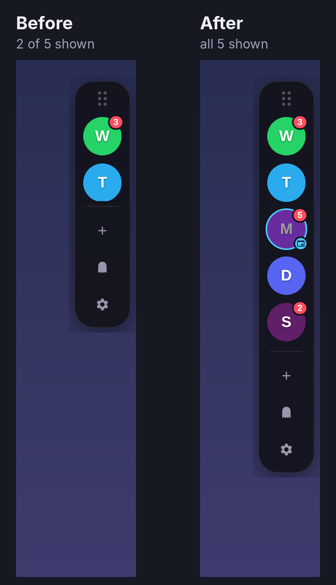

### Added
- **Vertical or horizontal layout.** Settings → Dock → *Layout*: a vertical rail
  on the left/right edge (as before) or a horizontal bar along the top/bottom.
  Dragging snaps to the nearest edge for the chosen layout; the panel opens
  beside, above or below the bar and keeps the *Panel width* setting.
- **Real service logos.** Bubbles show each service's logo, bundled from Simple
  Icons (CC0), so they work offline. Slack, LinkedIn and custom services keep the
  downloaded favicon. Snapchat's yellow gets a dark glyph so it stays readable.
- **Pinned chats as their own bubbles.** Press 📌 in the panel header (or
  right-click a service → *Pin the chat that's open*) to pin the conversation
  you're in. It appears as a smaller bubble right after its service's logo
  bubble, with the chat's initials and a small service badge. Click it to open
  that conversation; right-click to rename, pop it out as a floating chat head,
  open in browser, or unpin. Pinned chats are also listed (and can be unpinned)
  in Settings → Services, and a floating chat head comes back after a restart.
  Not available for WhatsApp and Snapchat, which use one address for every chat.
  Unread counts stay per service: a floating chat head shows a dot rather than
  a number, since the count belongs to the whole service.
- **Floating bubbles come back after a restart.** Chats you popped out as floating
  bubbles reopen when Bubbly launches, at the spot where you left them.
- **Clicking a chat's notification opens that chat.** Bubbly slides out and shows
  the chat in the panel, or expands its floating bubble. (Notifications a site
  sends from a background service worker aren't covered.)
- **Configurable show/hide shortcut.** Settings → System → *Show / hide shortcut*:
  click, then press a new combination (`Esc` cancels). The tray menu, tooltip and
  in-app hints all follow the new shortcut. Combinations that would interfere with
  typing (e.g. `Shift+B` alone) aren't accepted.
- **Shortcut conflict warning.** If another app already owns the shortcut, Bubbly
  says so (message on launch, warning in Settings, tray pop-up on Windows) instead
  of failing silently. Choosing a shortcut that's taken keeps your previous one.
- **Zoom is remembered per service**, and `Ctrl+0` resets to that service's
  default fit (e.g. Discord's 80%) instead of 100%.
- **Unit tests** (`npm test`) for unread-title parsing, the service catalog,
  zoom steps and shortcut recording.

### Fixed
- **Dragging could be undone on Linux.** Late window-move events from Bubbly's
  own slide animation were mistaken for a drag, which could snap the rail back
  or make it creep. Bubbly now recognises its own moves, and a real drag stops
  any slide in progress.
- **Rail clipped with 3+ services.** The collapsed rail stayed at its initial
  320px height, so with more than two services the rest were cut off. It now
  grows to fit every bubble.
- **Unread counts lost when a chat is popped out.** Floating bubbles now report
  their unread count back, so the rail badge and tray total stay correct.
- **Floating bubble head showed no badge when collapsed** until the count
  changed again; it now shows the current count right away.
- **Muting didn't update the total.** Muting or unmuting a service now updates
  the tray count and the red edge glow immediately.
- **`Ctrl +/−/0` didn't work while typing in a chat** (the keys went to the web
  page). They now work in the panel and in floating bubbles.
- **False unread badges.** Counts are read only from a `(n)` at the start or end
  of the page title, so titles like "Notes (2024) draft" no longer show a badge.
- **Removing a service left its floating bubble open**; it now closes too.
- **A chat closed from a floating bubble stopped tracking unreads** until you
  opened it again; it now resumes right away.
- **Broken-image icon in the panel header** when a service's icon can't load
  (e.g. offline); the header now just shows the name.

### Security
- Every chat view is forced into a sandboxed, context-isolated mode, can only
  load `http(s)` pages, and gets only Bubbly's own minimal preload
  (`webview-preload.js`, which relays notification clicks and nothing else).
- The permission handler is installed once per login session instead of once
  per page.

### Screenshots

| | |
| --- | --- |
| 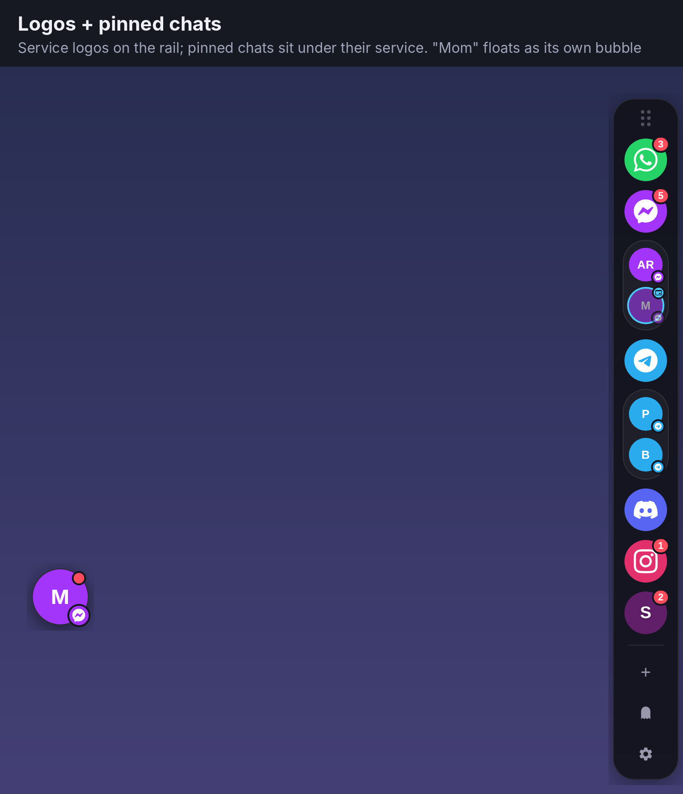 | 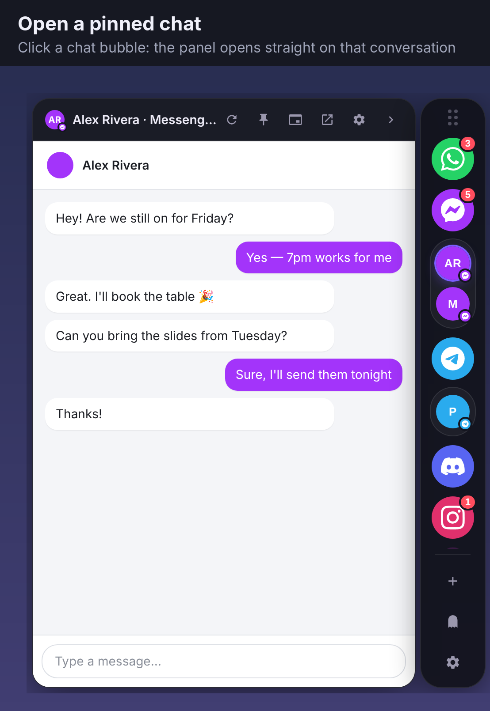 |
| 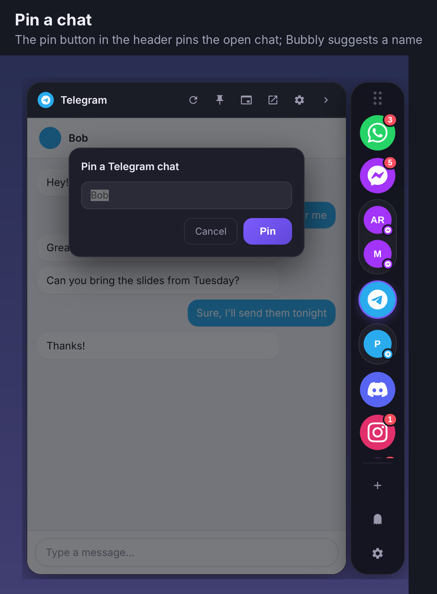 | 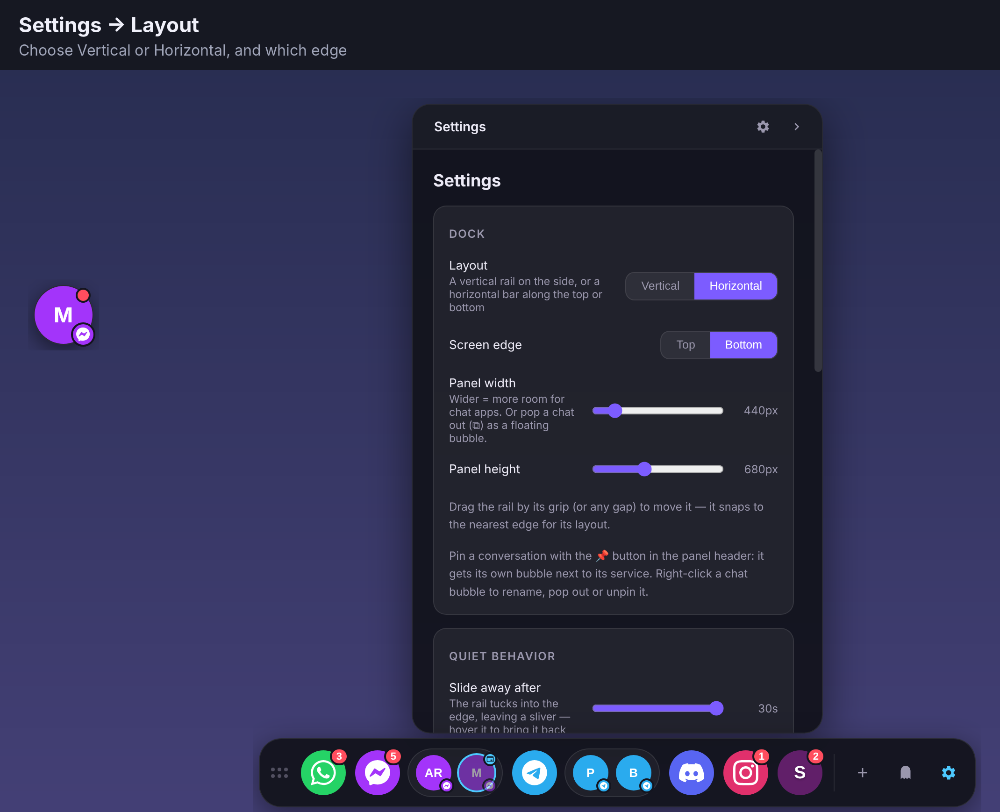 |
| 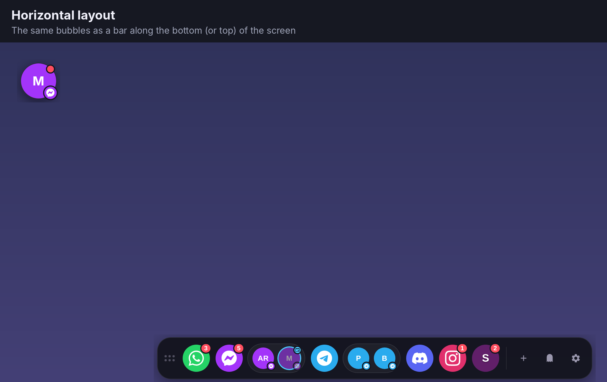 | 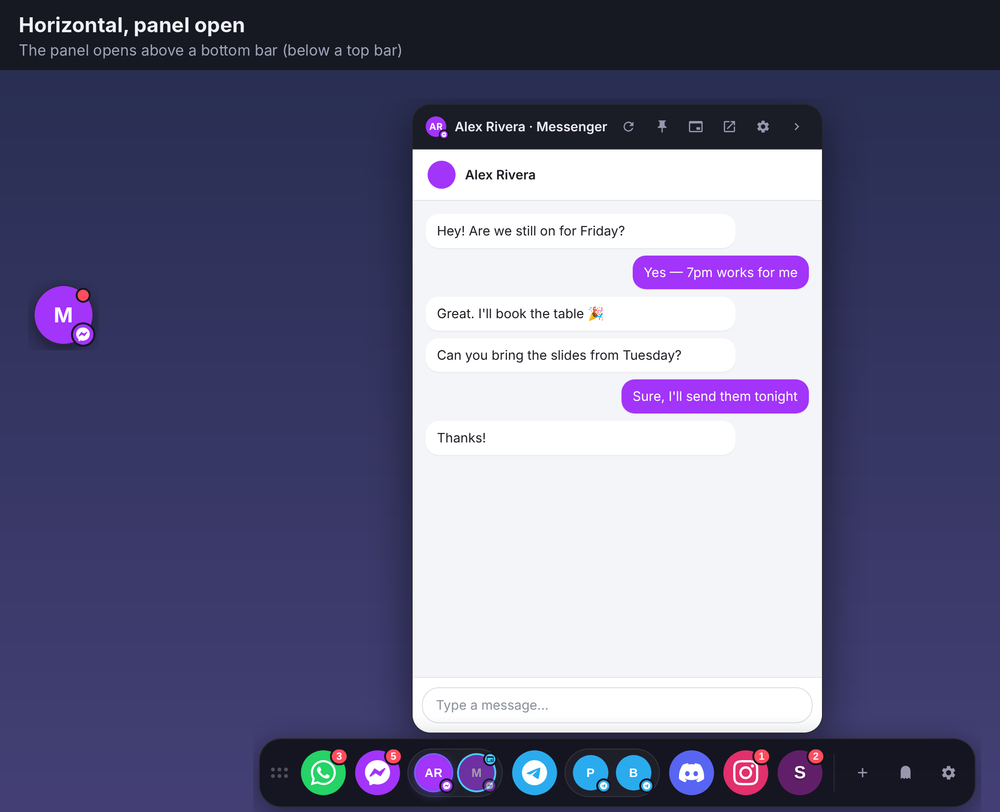 |
| 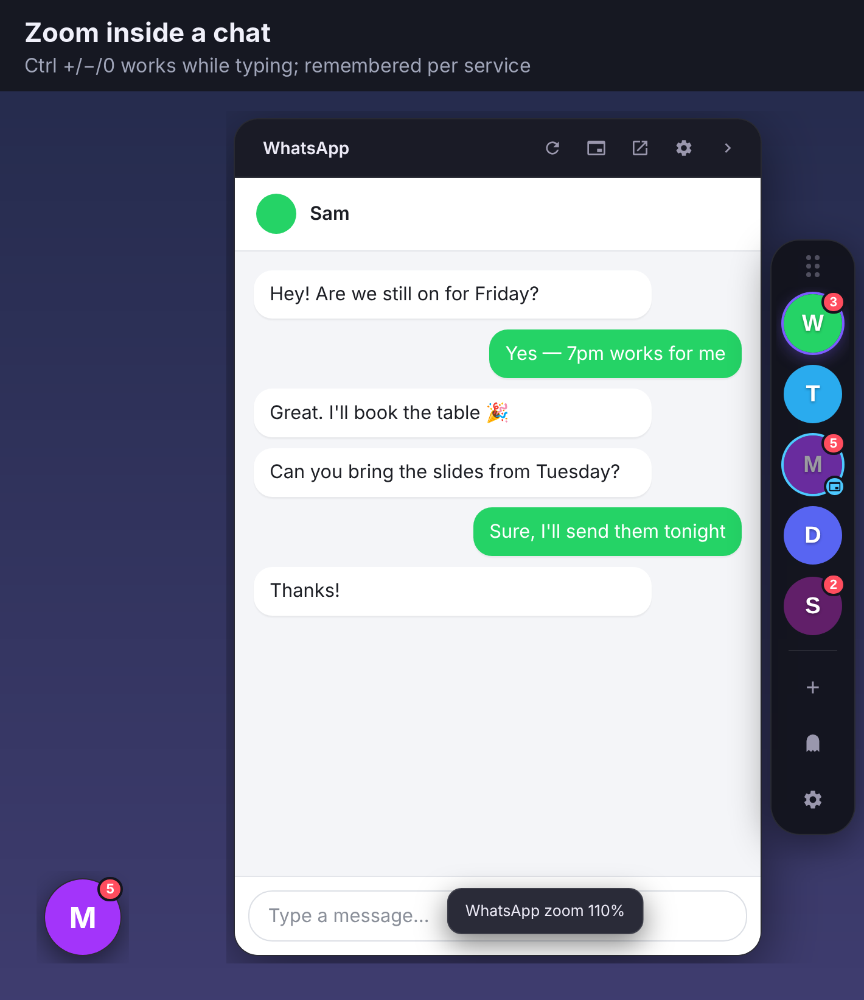 | 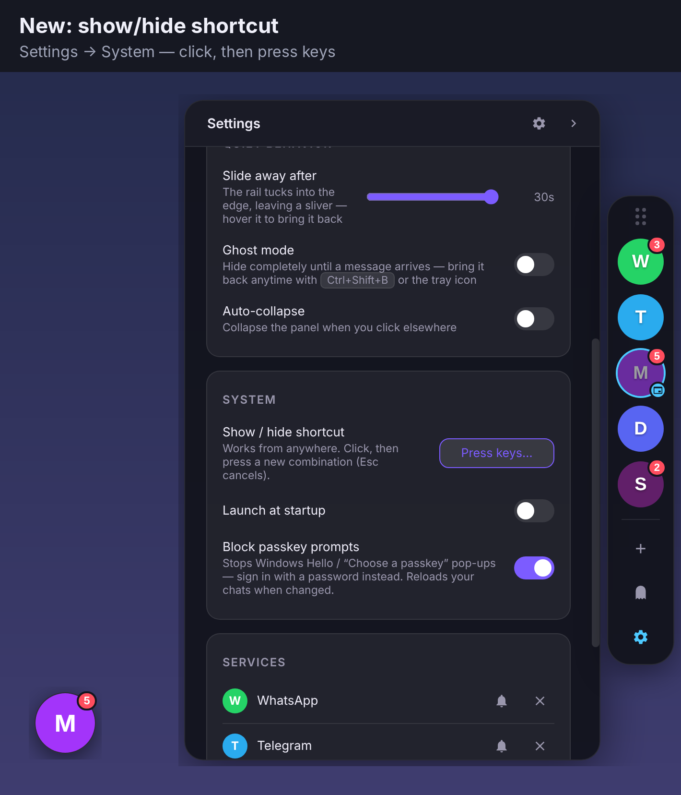 |
| 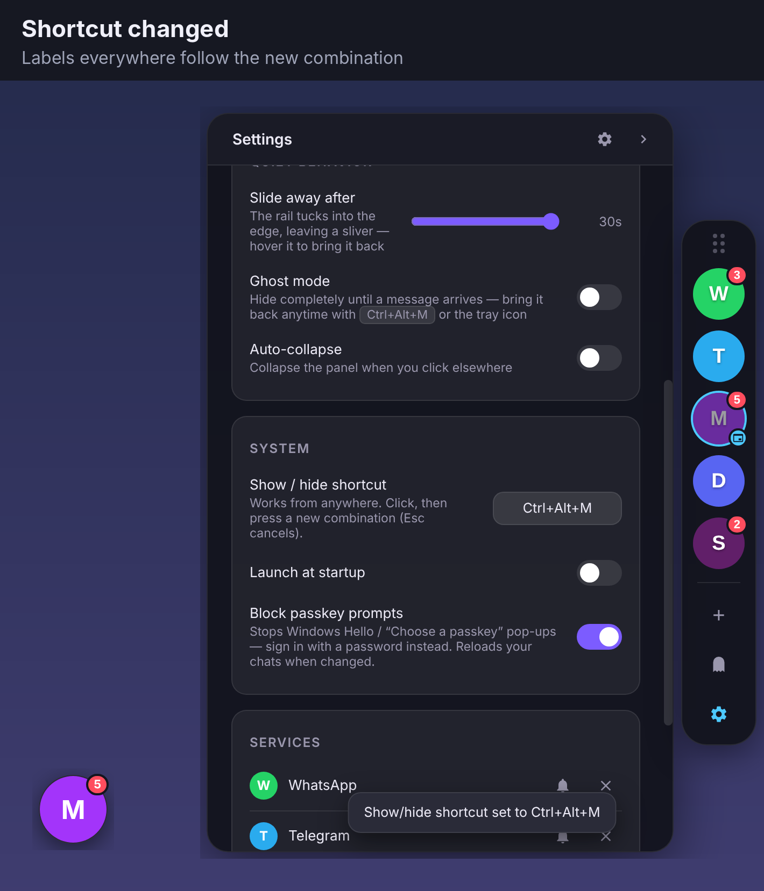 | 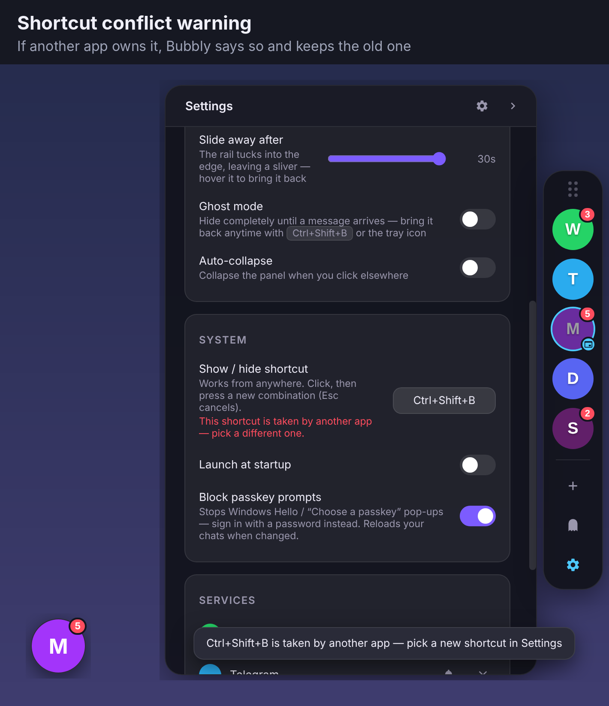 |

Screenshots were taken on Linux with local demo chat pages standing in for the
real services. Screenshots 2–5 predate the bundled logos, so icons there show
as letters; Slack shows a letter everywhere because its favicon couldn't be
downloaded in the test environment.

## [1.0.0] — original release

Initial version: edge rail, floating chat-head bubbles, slide-away idle, ghost
mode, isolated persistent logins, unread badges, per-service mute, passkey
blocking, Windows installer and portable builds.
